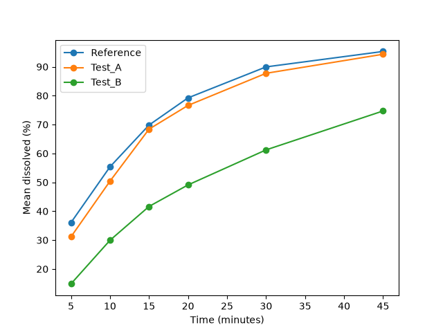
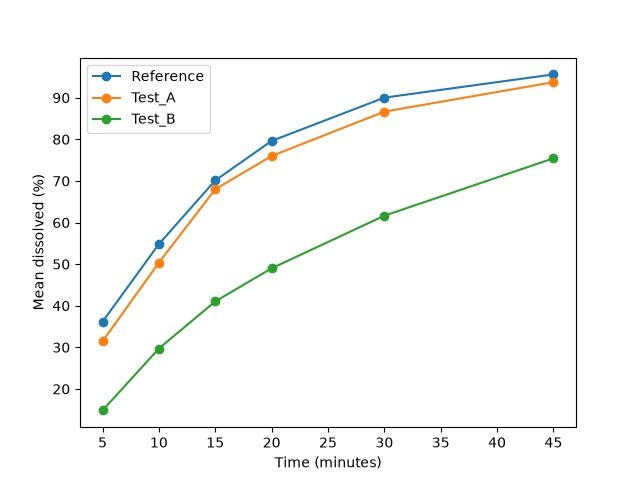

# dissolution-f2

A simple calculator for comparing dissolution profiles using the f1 and f2 factors, with rules taken from the FDA 1997 guidance (educational, synthetic data).

**Important:** All data in the `data/` folder is **synthetic** (randomly generated, fixed seed) and is for **demonstration only**. It does not represent any real product, batch, or study and must not be used for any regulatory or quality decision.

## Usage

```bash
.venv/bin/python f2_calculator.py data/sample_dissolution.csv --reference Reference
.venv/bin/python f2_calculator.py data/sample_dissolution_lowvar.csv --reference Reference
.venv/bin/python test_f2.py
```

Note: each run overwrites `outputs/f2_summary.csv` and `outputs/mean_profiles.png`.

Input: long-format CSV with columns `Product, Unit, Time_min, Percent_Dissolved`.
Output (saved to `outputs/`): `f2_summary.csv` (per Test: points used, f1, f2, verdict, variability status) and `mean_profiles.png` (mean profiles, Reference vs Tests). Results are also printed to the console.

The plot shows all time points, but f2 and f1 are calculated only from the time points retained after the 85% rule.

## Rules implemented (with PDF page refs)

Source: FDA 1997 guidance, *Dissolution Testing of Immediate Release Solid Oral Dosage Forms* (`docs/`). Page numbers are the **printed** page numbers. All rules sit in the constants block at the top of `f2_calculator.py`.

| Rule | Printed page |
|---|---|
| f2 = 50 * log10( [1 + (1/n) * sum((Rt - Tt)^2)]^-0.5 * 100 ), using mean values | p. 8 |
| f1 = ( sum\|Rt - Tt\| / sum(Rt) ) * 100 | p. 8 |
| 12 units per product (warning if different) | p. 9 |
| Same time points for Reference and Test (tool stops otherwise) | p. 9 |
| %CV at the earliest time point <= 20%; at other time points <= 10% (checked for Reference and Test) | p. 9 |
| Only one measurement after 85% dissolution of both products | p. 9 |
| f2 above 50 (50-100) and f1 0-15 are "generally" taken to ensure sameness/equivalence | p. 9 |
| Within-batch CV above 15% -> PDF suggests a multivariate model-independent method (note printed only, NOT implemented) | pp. 9-10 |

## Assumptions and limitations

- **ASSUMPTION (not defined in the PDF):** the PDF does not say which single measurement to keep after 85% dissolution. The tool keeps all time points up to and including the first one where BOTH the Reference mean and the Test mean are >= 85%, and drops later points. If that never happens, all points are used.
- "Earliest time point" for the 20% CV limit is taken as the first time point in the data; all later points use 10%. The PDF gives 15 min only as an example.
- SD and %CV use the sample standard deviation (n-1). The PDF does not specify this.
- A CV exactly at the limit passes (<=); the PDF says "not more than".
- Verdict wording follows the PDF ("generally"); when variability limits are exceeded, the verdict carries a note that the PDF's conditions for using mean data are not met.
- The multivariate confidence-region method and model-dependent approaches (pp. 9-10) are **not implemented**.
- The PDF's "three to four or more time points" suggestion (p. 9) is not enforced.
- Reference batch choice (most recent prechange batch) and identical test conditions are the user's responsibility; the tool cannot check them.
- The data is synthetic; results are for demonstration only.

## Example datasets

Both datasets are **synthetic** and for **demonstration only**.

- `data/sample_dissolution.csv` is **high-variability**. Its variability check fails by design (results saved as `outputs/f2_summary_highvar.csv` and `outputs/mean_profiles_highvar.png`).
- `data/sample_dissolution_lowvar.csv` is **low-variability** (target CV about 8% at 5 min, about 4% at later time points; same mean profiles as the first file). Results are in `outputs/f2_summary_lowvar.csv` and `outputs/mean_profiles_lowvar.png`.



*Mean profiles for `data/sample_dissolution.csv` (high-variability dataset). Synthetic data.*



*Mean profiles for `data/sample_dissolution_lowvar.csv` (low-variability dataset). Synthetic data.*

Note: the PDF wording for the f2 criterion is "greater than 50 (50-100)" (printed p. 9); this tool treats f2 = 50.0 exactly as similar.

## Disclaimer

This is an educational/portfolio tool that uses synthetic data. It has not been validated for GxP use (for example computerized system validation or 21 CFR Part 11), and its results must not be used for regulatory decisions.

## Source document

The rules implemented come from the FDA 1997 guidance *Dissolution Testing of Immediate Release Solid Oral Dosage Forms*. The PDF is not included in this repository; please download it from FDA's website.

Official source: https://www.fda.gov/regulatory-information/search-fda-guidance-documents/dissolution-testing-immediate-release-solid-oral-dosage-forms

## How to run

```bash
python3 -m venv .venv
```

```bash
.venv/bin/python -m pip install -r requirements.txt
```

```bash
.venv/bin/python test_f2.py
```

```bash
.venv/bin/python f2_calculator.py data/sample_dissolution.csv --reference Reference
```

```bash
.venv/bin/python f2_calculator.py data/sample_dissolution_lowvar.csv --reference Reference
```

Note: each calculator run writes `outputs/f2_summary.csv` and `outputs/mean_profiles.png`, overwriting any earlier run. Rename them if you want to keep results from both datasets.
